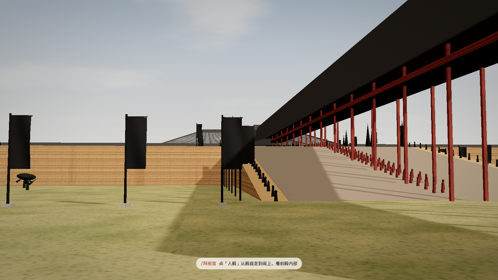
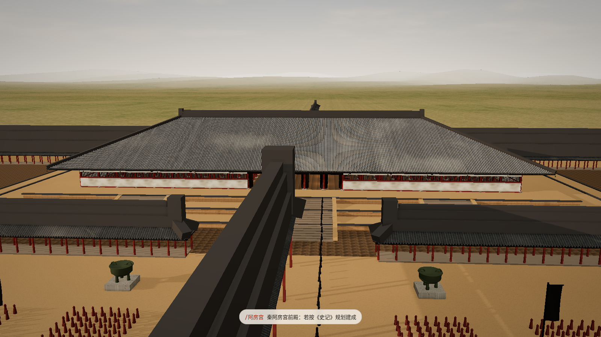
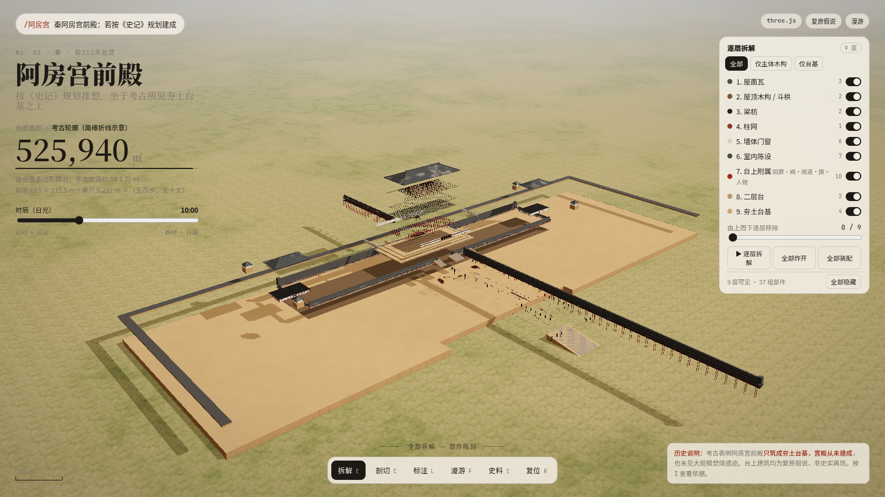
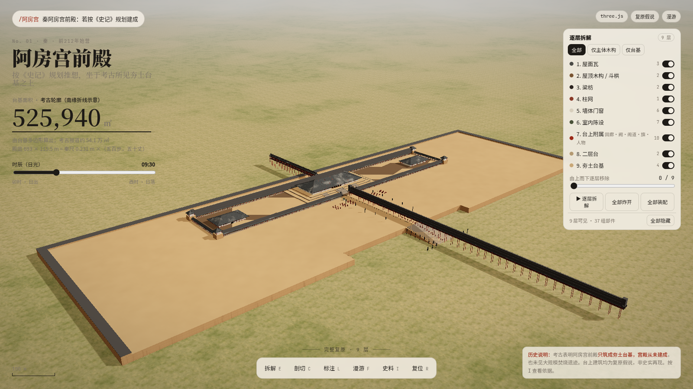
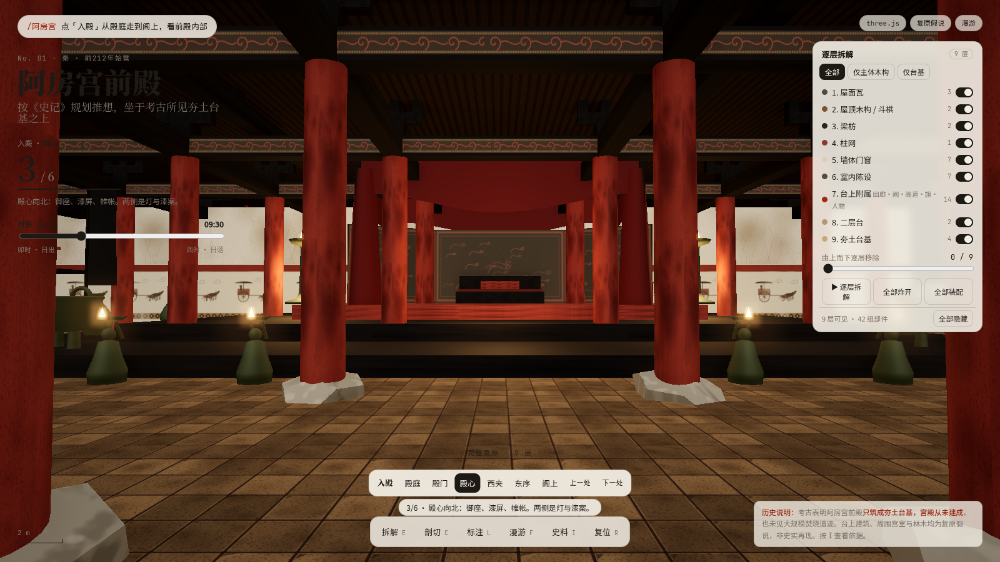
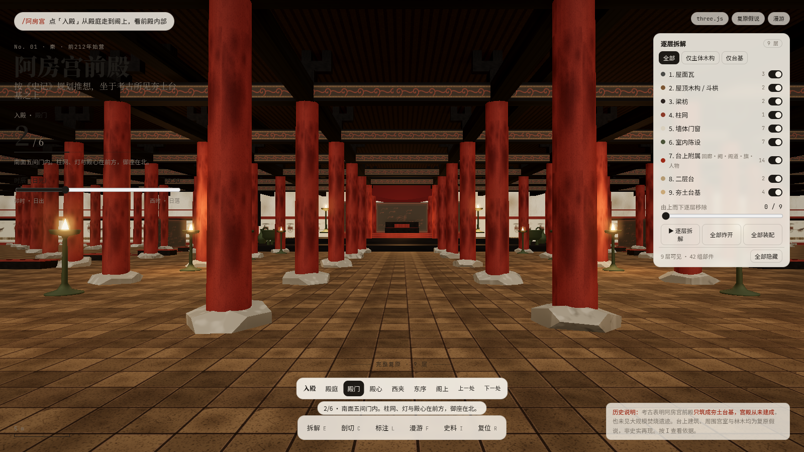
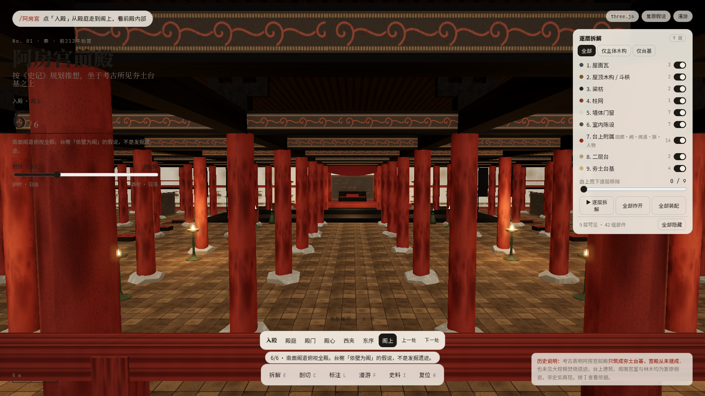

<p align="center">
  
</p>

<h1 align="center">Epang Palace Front Hall · 阿房宫前殿</h1>

<p align="center">
  <strong>Walk through a hall the archaeology says was never finished.</strong><br>
  把一座只建成夯土台基的朝宫，做成可以走进去的三维假说。
</p>

<p align="center">
  The rammed-earth terrace follows published archaeology. The buildings on it are a hypothesis of what the Shiji plan might have looked like if it had been completed.
</p>

<p align="center">
  <a href="https://tuanziding.github.io/epang-palace/"><strong>Open the live page · 打开在线演示</strong></a><br>
  <a href="https://tuanziding.github.io/epang-palace/">https://tuanziding.github.io/epang-palace/</a>
</p>

<p align="center"><sub>A push to <code>main</code> runs <a href="https://github.com/TUANZIDING/epang-palace/actions/workflows/pages.yml">Publish site</a>, which deploys root <code>index.html</code> to the URL above.</sub></p>

<p align="center">
  <a href="../README.md">简体中文</a> · <a href="英文说明v1.0.md">English</a>
</p>

<p align="center">
  <a href="https://github.com/TUANZIDING/epang-palace/actions/workflows/pages.yml"></a>
</p>

<p align="center">
  <code>single-file three.js</code> · <code>layer peel</code> · <code>interior viewpoints</code> · <code>first-person walk</code>
</p>

<p align="center">
  <a href="#use-cases">Use cases</a> ｜ <a href="#showcase">Showcase</a> ｜ <a href="#quick-start">Quick start</a> ｜ <a href="#controls">Controls</a> ｜ <a href="#capabilities">Status</a> ｜ <a href="#contribute">Notes</a>
</p>

<p align="center"><sub>The cover is a screenshot of this scene, not a photograph and not a record of a finished palace.</sub></p>

> **Historical limit.** Archaeology found only the rammed-earth terrace of the Epang Palace front hall. The hall itself was never completed. No Qin palace buildings were found on the terrace, and it was not burned on a large scale. Every building in this scene is a reconstruction hypothesis — what the Shiji scheme might have looked like if built — not a historical record. The same note is in the page corner and in the sources panel (`I`).

---

<a id="use-cases"></a>

## What you can do with it · Use cases

| You want to | Start here |
| --- | --- |
| See the whole terrace, then enter the hall | [Live page](https://tuanziding.github.io/epang-palace/) or [`index.html`](../index.html) |
| Peel it like an atlas | The layer panel, top to bottom: tiles, roof timber, beams, columns, walls, furnishings, terrace buildings, upper platform, rammed earth |
| Separate evidence from guesswork | Press `I`, then read [`brief.md`](../brief.md) |
| Walk the axis, or jump inside | Press `F` to walk. Or use Enter the hall: court → doorway → center → west aisle → east aisle → upper gallery |

<a id="showcase"></a>

## Four views of one hypothesis · Showcase

These files in `shots/` are renders of this three.js scene.

| Axis view | Exploded assembly |
| --- | --- |
| [](https://tuanziding.github.io/epang-palace/) | [](https://tuanziding.github.io/epang-palace/) |
| [Open the page](https://tuanziding.github.io/epang-palace/) | [Open the page](https://tuanziding.github.io/epang-palace/) |

| Overview | Hall center |
| --- | --- |
| [](../shots/01_overview.png) | [](../shots/24_tour_center.png) |
| [Full image](../shots/01_overview.png) | [Full image](../shots/24_tour_center.png) |

| Inside the doors | Upper gallery |
| --- | --- |
| [](../shots/23_tour_door.png) | [](../shots/26_tour_gallery.png) |
| [Full image](../shots/23_tour_door.png) | [Full image](../shots/26_tour_gallery.png) |

<sub>Also `shots/22_tour_court.png`, `shots/25_tour_west.png`, and `shots/27_surroundings_hero.png`. Tiles, lacquer, screens, bells, outbuildings, and trees are marked as speculative in the scene.</sub>

<a id="quick-start"></a>

## Quick start

The page needs a network to load three.js 0.170 from jsDelivr and the webfonts. There is no build and no API key.

**Live:** [https://tuanziding.github.io/epang-palace/](https://tuanziding.github.io/epang-palace/)

**Local**, from the repository root:

```sh
python3 -m http.server 8080 --bind 127.0.0.1
```

Open http://127.0.0.1:8080/ . You can also open `index.html` directly. Add `?q=low` to turn off ambient occlusion and the lamp bloom.

[Design brief](../brief.md) · [简体中文](../README.md)

<a id="controls"></a>

## Controls

| Mode | Key | What it does |
| --- | --- | --- |
| Explode / reassemble | `E` | Parts fly apart along their assembly axes; press again to return. An assembly plays on load |
| Cutaway | `C` | Longitudinal section 4.5 m east of the axis, hatched in red |
| Labels | `L` | Chinese callouts. Speculative items are marked |
| Walk | `F` | `WASD` or arrows, mouse look, `Shift` to run, space to jump, `Esc` or `F` to leave |
| Enter the hall | on-screen · `[` `]` | Court → doorway → center → west aisle → east aisle → upper gallery. The view eases in and pans; drag to look yourself. `F` then walks from that spot |
| Sources | `I` | Evidence, unit conversion, speculative list, citations |
| Reset | `R` | Overview camera, all layers restored |
| Time of day | slider | 06:00–18:00. Sun direction uses the latitude of Xi'an |
| Layers | right panel | Nine toggles, solo a layer, peel with the slider, auto-peel, explode all, assemble from the ground up |

Layer order: 1 roof tiles → 2 roof timber / brackets → 3 beams → 4 columns → 5 walls and doors → 6 furnishings → 7 courtside structures → 8 upper platform → 9 rammed-earth terrace.

<a id="workflow"></a>

## Read it from the ground up · Workflow

**Overview → peel layers → cut or label → walk in → press `I`**

| Goal | Support in the page |
| --- | --- |
| Keep only what the dig supports | Preset “terrace only”, or peel down to the rammed earth |
| See how the timber stacks | “Main timber only”, or assemble upward |
| Inspect the furnishings | Use Enter the hall, or walk in with `F`. Vessels, lamps, tables, screens, bells, and the canopy explode and also block movement |
| Drive it from a script | `window.__app`: `peel`, `setLayers`, `playPeel`, `assembleAll`, `cine` |

<a id="capabilities"></a>

## What is actually claimed · Capability status

| Status | Content | Limit |
| --- | --- | --- |
| Implemented | One HTML file: layers, explode, cutaway, labels, walk, Qin-style furnishings, sun and soft shadows | Buildings, bays, roof, galleries, and furnishings are speculative |
| Archaeological base | Terrace about 1270 × 426 × 12 m; walls on the west, north, and east; south side open | The kink in the south edge is a diagram of a 2025 find, not a survey line |
| Textual size | Court taken as 500 bu by 50 zhang at 0.231 m per Qin chi | The chi value, and the idea that the text describes the court rather than the whole terrace, are not settled |
| Deliberately unused | Wang Guixiang, chapter on this hall in *Vanished Glory* | The text was not obtained and its conclusions are not used |
| Captures on record | `tools/shots.mjs` and `tools/shots_tour.mjs`; interior frames are `shots/22`–`shots/27` | Those notes describe a software-render check, not a GPU frame rate and not archaeological sign-off |

<details>
<summary><strong>Dimensions, materials, recapture</strong></summary>

Citations and the speculative list are in [`brief.md`](../brief.md).

- Terrace 1270 × 426 × 12 m. The on-page polygon is 525,940 m²; the gap versus the reported ~541,000 m² comes from the diagrammed south edge.
- Court 693 × 115.5 m on the north half of the terrace. Column grid, upper platform, side halls, towers, and covered ways are speculative.
- Hip roof, no owl-tail ridge ornaments. The upper platform is drawn as three rammed tiers. Film-set photos informed only the axial composition, not the history.
- Materials are procedural: rammed earth, tiles, cloud-pattern eave ends, red columns, black beams, brick paving, lacquer screens, bronze lamps. No photo textures.
- Sun path is for Xi'an (34.2°N) around 14 October. Shadow coverage tightens with the camera. `?q=low` disables AO and bloom.

Recapture, with a local Chrome:

```sh
cd tools && npm i && node shots.mjs
```

</details>

<a id="contribute"></a>

## Notes

Corrections to measurements, citations, and interaction bugs are welcome. Keep archaeological facts and design guesses in separate sentences.

| Topic | Where |
| --- | --- |
| Evidence and sizes | [brief.md](../brief.md) |
| Chinese homepage | [README.md](../README.md) |
| Live page | [tuanziding.github.io/epang-palace](https://tuanziding.github.io/epang-palace/) |
| Publish workflow | [pages.yml](../.github/workflows/pages.yml) |
| Issues | [GitHub Issues](https://github.com/TUANZIDING/epang-palace/issues) |

---

<p align="center">
  <strong>Epang Palace Front Hall · 阿房宫前殿</strong><br>
  The terrace is what the dig left. The buildings are a hypothesis you can walk through.<br>
  <a href="https://github.com/TUANZIDING">TUANZIDING</a> · <a href="../brief.md">Design brief</a> · <a href="https://github.com/AirsupHQ/machine-skill">machine-skill</a>
</p>

<sub>This repository has no separate LICENSE file. The interaction pattern follows machine-skill (MIT) lab-kit but does not inline that code. Historical texts and archaeological reports are cited, not copied. Those projects do not endorse this reconstruction.</sub>
